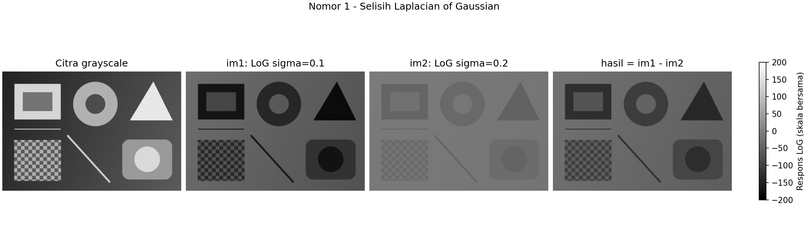
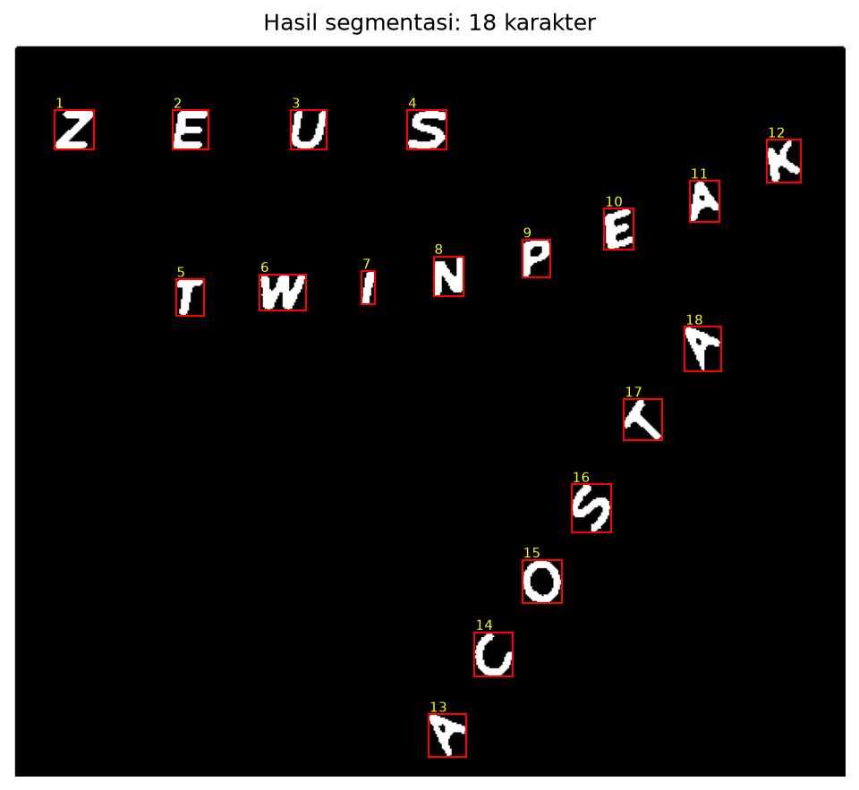
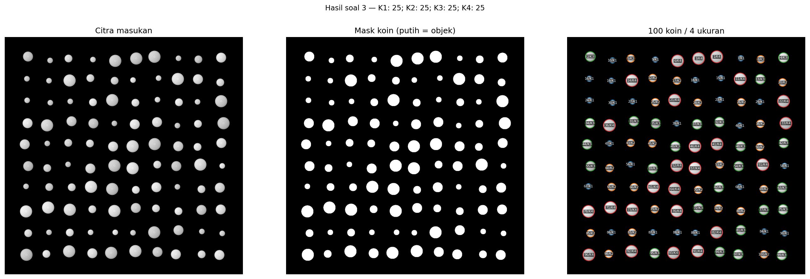

# UTS Pengolahan Citra Digital - Kelompok 9

Penyelesaian **nomor 1, 2, dan 3** untuk INF301, semester gasal 2026/2027.
Setiap soal memiliki folder program dan hasilnya sendiri. Pembagian pekerjaan:

| Anggota | NRP | Bagian |
| --- | --- | --- |
| Bambang Herlambang | 5803024019 | Nomor 1 dan 3 |
| Dustin Pranata Wangsawidjaja | 5803024021 | Nomor 2 |

Nomor 2 mencakup pemisahan karakter menggunakan `regionprops`.
Laporan gabungan dan presentasi mencakup ketiga soal. Panduan khusus tersedia
di [README soal 1](soal1/README.md), [README soal 2](soal2/README.md), dan
[README soal 3](soal3/README.md).

## Cara menjalankan di Windows (PowerShell)

Gunakan Python 3.10 atau lebih baru. Buka terminal di folder repositori.
Persiapan berikut cukup dilakukan sekali pada setiap komputer:

```powershell
python -m venv .venv
.\.venv\Scripts\python.exe -m pip install -r requirements.txt
```

Setelah persiapan selesai, jalankan program atau demo dengan:

```powershell
.\.venv\Scripts\python.exe soal1/main.py
Push-Location soal2
..\.venv\Scripts\python.exe main.py
Pop-Location
.\.venv\Scripts\python.exe soal3/main.py
```

Perintah tersebut langsung memakai Python di `.venv` tanpa perlu aktivasi.
Folder `.venv` dibuat di masing-masing komputer dan diabaikan oleh Git.
Hasil disimpan ke `soal1/hasil/`, `soal2/hasil_karakter/`, dan `soal3/hasil/`.
Nomor 2 dijalankan dari dalam folder `soal2/` karena program membaca
`teks.png` dari folder kerja. `Push-Location` masuk ke folder tersebut dan
`Pop-Location` kembali ke folder utama. Program nomor 2 membuka jendela
visualisasi; tutup jendelanya agar perintah berikutnya dapat dilanjutkan.
Program nomor 1 dan 3 berjalan tanpa jendela grafik, dengan lokasi data dan
hasil default mengikuti folder program.

Data contoh dan hasil eksekusi sudah disertakan. Untuk memeriksa hasil tanpa
menjalankan ulang, buka [LAPORAN.md](LAPORAN.md) serta folder hasil tiap soal.
Untuk demo, buka [perbandingan nomor 1](soal1/hasil/perbandingan.png),
[segmentasi karakter nomor 2](soal2/hasil_karakter/_visualisasi_bbox.png), dan
[ringkasan visual nomor 3](soal3/hasil/ringkasan_visual.png).

## Berkas utama

| Berkas | Kegunaan |
| --- | --- |
| [soal1/main.py](soal1/main.py) | LoG sigma 0,1 dan 0,2; simpan `im1`, `im2`, dan selisih |
| [soal2/main.py](soal2/main.py) | Segmentasi karakter dengan `regionprops` dan simpan gambar tiap karakter |
| [soal2/README.md](soal2/README.md) | Penjelasan metode dan hasil pekerjaan Dustin |
| [soal3/main.py](soal3/main.py) | Segmentasi koin, `regionprops`, dan jumlah per kelompok ukuran |
| [LAPORAN.md](LAPORAN.md) | Asumsi, kode semu, rumus, metode, hasil, dan batasan ketiga soal |
| [laporan/latex/main.tex](laporan/latex/main.tex) | Sumber laporan LaTeX ketiga soal dengan sampul dan gambar hasil |
| [Paket sumber LaTeX (ZIP)](laporan/latex/laporan-uts-pcd-kelompok-9.zip) | Seluruh sumber dan gambar untuk disunting atau dikompilasi |
| [Laporan PDF](laporan/pdf/laporan-uts-pcd-kelompok-9.pdf) | Laporan ketiga soal siap dibaca dan dicetak |
| [Presentasi PowerPoint](laporan/ppt/presentasi-uts-pcd-kelompok-9-biru.pptx) | Tema biru, 11 slide: sampul, 3 slide per soal, dan penutup; seluruh materi terisi |
| [Panduan presentasi](laporan/ppt/panduan-presentasi.md) | Alokasi waktu, persiapan demo, dan gambar cadangan |
| `buat_data_contoh.py` | Membuat ulang data sintetis dengan seed tetap |
| [soal1/data/](soal1/data/) | Citra uji LoG |
| [soal1/hasil/](soal1/hasil/) | Array numerik, PNG hasil, panel perbandingan, metadata |
| [soal2/teks.png](soal2/teks.png) | Citra teks masukan untuk segmentasi karakter |
| [soal2/hasil_karakter/](soal2/hasil_karakter/) | 18 gambar karakter terpisah dan visualisasi kotak pembatas |
| [soal3/data/](soal3/data/) | Citra 100 koin dan ground truth untuk validasi |
| [soal3/hasil/](soal3/hasil/) | Mask, label, anotasi, tabel pengukuran CSV, ringkasan JSON |
| [soal1/tests/test_log.py](soal1/tests/test_log.py) | Pengujian numerik LoG dan selisih bertanda |
| [soal3/tests/test_koin.py](soal3/tests/test_koin.py) | Pengujian segmentasi dan penghitungan koin |

Data contoh nomor 1 dan 3 adalah **simulasi**. Citra koin bukan foto koin nyata dan memiliki
empat ukuran, masing-masing 25 buah. Program penghitung hanya membaca gambar;
berkas [soal3/data/koin_100_ground_truth.json](soal3/data/koin_100_ground_truth.json)
dipakai untuk pengujian terpisah.

## Nomor 1

```powershell
.\.venv\Scripts\python.exe soal1/main.py --input "D:\gambar\citra.png" --output-dir soal1/hasil_citra_saya
```

Default memakai [soal1/data/citra_uji.png](soal1/data/citra_uji.png), sigma 0,1 dan 0,2 **piksel**,
`hasil = im1 - im2`, dan perluasan batas `reflect`.

- `im1.npy`, `im2.npy`, `hasil.npy`: nilai sebenarnya, float64 bertanda.
- `im1.png`, `im2.png`, `hasil.png`: pratinjau dengan skala bersama; nol abu-abu.
- `grayscale.png`, `perbandingan.png`, `metadata.json`: masukan grayscale,
  tampilan gabungan, parameter dan rentang nilai.

Pengurangan dilakukan pada respons asli sebelum konversi ke PNG. Sigma pada
soal jauh di bawah satu piksel, sehingga sampling kernel LoG menghasilkan
bias DC; tampilan hasil dapat menyerupai negatif citra. Penjelasan numeriknya
tersedia di laporan. Nilai sigma tidak diganti secara diam-diam.



## Nomor 2

Mulai dari folder utama repositori, jalankan:

```powershell
Push-Location soal2
..\.venv\Scripts\python.exe main.py
Pop-Location
```

Program membaca [teks.png](soal2/teks.png), mengubahnya menjadi grayscale,
menerapkan ambang Otsu, membersihkan objek kecil, lalu memberi label komponen
terhubung. `regionprops` menyediakan kotak pembatas, mask tiap karakter, dan
centroid. Mask setiap region disimpan secara terpisah dengan margin hitam.
Pengurutan karakter memakai RANSAC pada centroid untuk mengelompokkan baris
teks yang miring.

Hasil pada citra yang disertakan: **18 karakter** (ZEUS, TWINPEAK, dan ACOSTA).
Gambar `karakter_01.png` sampai `karakter_18.png` serta visualisasi kotak
pembatas berada di [soal2/hasil_karakter/](soal2/hasil_karakter/).
Tutup jendela visualisasi setelah selesai agar terminal dapat melanjutkan.

Asumsi program adalah karakter terang pada latar gelap dan tidak saling
bersentuhan. Karakter bersentuhan dapat tergabung, sedangkan karakter yang
memiliki bagian terpisah dapat terdeteksi sebagai beberapa objek.
Penjelasan lebih lanjut tersedia di [README soal 2](soal2/README.md).



## Nomor 3

```powershell
.\.venv\Scripts\python.exe soal3/main.py --input "D:\gambar\koin.png" --output-dir soal3/hasil_koin_saya
```

Default memakai [soal3/data/koin_100.png](soal3/data/koin_100.png).
Koin harus terpisah, terlihat utuh, dan kontras terhadap latar seragam.
Mayoritas piksel bingkai gambar harus merupakan latar. Program memilih
polaritas terang/gelap secara otomatis, lalu mengelompokkan diameter
ekuivalen menggunakan toleransi relatif 8%.

Pilihan penyesuaian:

```powershell
.\.venv\Scripts\python.exe soal3/main.py --size-tolerance 0.05 --min-area 50 --expected-count 100
```

`--min-area` bersatuan piksel persegi. `--expected-count` hanya menghasilkan
peringatan jika jumlah berbeda; jumlah deteksi tidak dipaksa menjadi 100.
Gunakan `--expected-count 0` untuk menonaktifkan pemeriksaan tersebut.
Kelompok ukuran berupa diameter dalam piksel, bukan nominal mata uang.

Hasil contoh: **100 koin, 4 kelompok ukuran, masing-masing 25 koin**.
Lihat [ringkasan.json](soal3/hasil/ringkasan.json) untuk jumlah dan statistik
ukuran, [objek_koin.csv](soal3/hasil/objek_koin.csv) untuk pengukuran tiap koin,
serta [anotasi_koin.png](soal3/hasil/anotasi_koin.png) untuk posisi dan kelompoknya.



## Pengembangan tambahan: foto dengan pencahayaan tidak merata

Metode bawaan tetap Otsu sesuai asumsi latar seragam. Pilihan watershed
berbasis gradien Sobel tersedia untuk uji tambahan:

```powershell
.\.venv\Scripts\python.exe soal3/main.py --input soal3/data/koin_nyata_scikit.png --output-dir soal3/hasil_foto_nyata_watershed --method watershed --expected-count 24
```

Foto ini berisi **24 koin**, bukan pengganti data utama 100 koin.
Pada Otsu, satu koin menyatu dengan latar walaupun jumlah region sama-sama
24. Watershed memisahkan 24 pusat koin ke region berbeda. Parameter
penanda perlu disesuaikan untuk foto lain; hasil ini tidak menjamin semua
foto nyata. Lihat [perbandingan dan batasan uji foto nyata](soal3/UJI_FOTO_NYATA.md).

## Membuat ulang data dan menjalankan pengujian (opsional)

```powershell
.\.venv\Scripts\python.exe buat_data_contoh.py --seed 9
.\.venv\Scripts\python.exe soal1/main.py
.\.venv\Scripts\python.exe soal3/main.py
.\.venv\Scripts\python.exe -m pip install -r requirements-dev.txt
.\.venv\Scripts\python.exe -m pytest -q
```

Perintah `pytest -q` di atas menjalankan seluruh pengujian dari folder
repositori. Saat ini 12 kasus pengujian otomatis mencakup nomor 1 dan 3, termasuk empat kasus tambahan watershed.
Untuk menjalankan pengujian tiap bagian secara terpisah:

```powershell
.\.venv\Scripts\python.exe -m pytest -q soal1/tests
.\.venv\Scripts\python.exe -m pytest -q soal3/tests
```

Generator menyimpan data ke `soal1/data/` dan `soal3/data/` di dalam folder
repositori secara default. Pembuatan ulang dengan folder dan seed yang sama
menimpa data contoh tersebut. Pada generator, `--output-dir` menentukan folder
akar struktur keluaran. Contohnya, `--output-dir percobaan` membuat
`percobaan/soal1/data/` dan `percobaan/soal3/data/`; gunakan `--input` pada
program terkait untuk memilih citra dari folder percobaan itu.

Implementasi sudah dijalankan dengan Python 3.10, NumPy 2.2.6, SciPy 1.15.3,
scikit-image 0.25.2, Matplotlib 3.10.9, dan Pillow 12.3.0.
