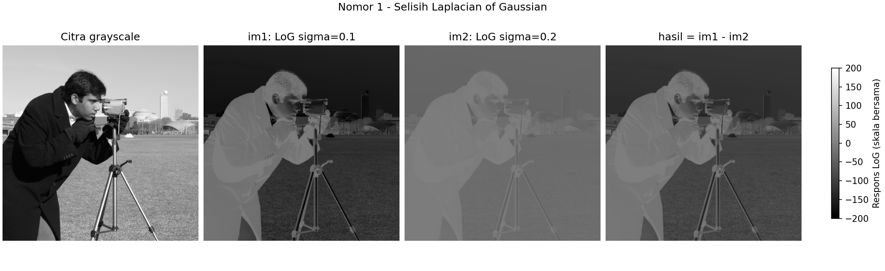

# Uji soal 1 pada foto nyata

Foto masukan: [data/foto_kamera_scikit.png](data/foto_kamera_scikit.png),
salinan tanpa perubahan dari `skimage.data.camera()`, berukuran 512 x 512
piksel. Foto ini bukan citra sintetis dan bukan masukan kamera langsung.
Menurut [dokumentasi scikit-image](https://scikit-image.org/docs/stable/api/skimage.data.html#skimage.data.camera),
foto dilisensikan CC0 oleh fotografer Lav Varshney.

## Menjalankan dari folder utama repositori

```powershell
.\.venv\Scripts\python.exe soal1/main.py --input soal1/data/foto_kamera_scikit.png --output-dir soal1/hasil_foto_nyata
```

Parameter tetap mengikuti soal: sigma 0,1 untuk `im1`, sigma 0,2 untuk
`im2`, mode batas `reflect`, dan `hasil = im1 - im2`. Kode utama serta hasil
citra sintetis di `soal1/hasil/` tidak diubah.

## Hasil

| Respons asli | Minimum | Maksimum |
| --- | --- | --- |
| im1 | -200,000000 | 0,000000 |
| im2 | -49,992070 | 0,000075629 |
| hasil | -150,009317 | -0,000075629 |

Angka tabel dibulatkan; nilai lengkap tersimpan dalam NPY dan metadata.
Pemeriksaan array tersimpan membuktikan bahwa `hasil.npy` sama persis
dengan `im1.npy - im2.npy`. Ketiga array bertipe float64. PNG memakai satu
skala tampilan bersama, dengan nilai nol di sekitar abu-abu 128.



Pada foto ini, selisih tetap menyerupai negatif citra. Korelasi dengan
masukan sekitar -0,999999999979. Ini konsisten dengan bias DC akibat
sampling kernel pada sigma sangat kecil, bukan bukti terbentuknya peta
tepi ideal. Mengganti citra sintetis dengan foto nyata tidak menghilangkan
perilaku numerik tersebut. Sigma tidak diganti dalam uji ini.

Panel hasil ada di [hasil_foto_nyata/perbandingan.png](hasil_foto_nyata/perbandingan.png),
dan rincian parameter di [metadata.json](hasil_foto_nyata/metadata.json).
